# Land Record Digitization — Final Workflow (v3)

**Merges:** v1 Blueprint (domain coverage) + v2 Architecture (engineering) + review fixes
**Date:** 28 Sep 2026

---

## 1. End-to-end flow

```mermaid
flowchart TD
  %% ---------- INGESTION ----------
  subgraph ING["1 · Ingestion"]
    A1["Officer web upload"]
    A2["Vendor bulk batch<br/>(SFTP / zip + manifest)"]
    A3["Field PWA capture<br/>(offline queue)"]
    B["Metadata: state, district, tehsil,<br/>village LGD, doc type, register, year"]
    C["SHA-256 hash + store raw scan<br/>(S3, versioned, WORM)"]
    D{"Image duplicate?<br/>(hash / pHash)"}
  end
  A1 & A2 & A3 --> B --> C --> D
  D -- "exact duplicate" --> DUP["Link to existing doc · status DUPLICATE"]
  D -- "new" --> T["Temporal workflow ProcessDocument starts"]

  %% ---------- TRIAGE ----------
  subgraph TRI["2 · Triage & preprocessing"]
    E{"Born-digital PDF<br/>with text layer?"}
    F["Font detection →<br/>legacy font (Kruti Dev etc.) → Unicode"]
    G["Preprocess (OpenCV): deskew, denoise,<br/>binarise, contrast, page split, quality score"]
    H["Document classifier:<br/>RoR · Khatauni/Jamabandi · 7/12 · Pahani ·<br/>mutation register · deed · map sheet"]
  end
  T --> E
  E -- "yes" --> F --> H
  E -- "no / scanned" --> G --> H
  G -. "low quality: flag, never reject" .-> H

  H -- "map sheet" --> MAP
  H -- "text record" --> L

  %% ---------- TEXT EXTRACTION ----------
  subgraph TXT["3 · Text extraction"]
    L["Layout analysis: tables, text blocks,<br/>margin notes, stamps/seals"]
    S["Per region: script ID +<br/>printed vs handwritten"]
    O1["Printed Indic OCR"]
    O2["Handwriting (HTR) model per script"]
    X["Field extraction: state/doc-type template + NER<br/>→ owners[], khasra[], khata, survey, area,<br/>land class, mutation, registration"]
    NRM["Normalise: area units (bigha/guntha/kanal → sqm),<br/>dates, digits, transliteration"]
  end
  L --> S
  S -- "printed" --> O1 --> X
  S -- "handwritten" --> O2 --> X
  X --> NRM --> V

  %% ---------- MAP BRANCH ----------
  subgraph MAP["3b · Map digitization"]
    M1["Georeference sheet<br/>(GCPs / Bhu-Naksha village boundary)"]
    M2["Boundary segmentation → vectorise polygons"]
    M3["Topology check: gaps, overlaps, slivers"]
    M4["OCR parcel numbers on map"]
  end
  M1 --> M2 --> M3 --> M4 --> V

  %% ---------- VALIDATION ----------
  subgraph VAL["4 · Validation & scoring"]
    V["Business rules: formats, mandatory fields,<br/>plausible area, shares sum to 1"]
    V2["Master data: LGD codes, survey range"]
    V3["Cross-DB: LRMS / Bhulekh / NGDRS / Bhu-Naksha"]
    V4["Record dedup + conflict detection<br/>(fuzzy + transliteration)"]
    V5["Parcel match → ULPIN link ·<br/>map area vs text area reconciliation"]
    CS["Calibrated per-field confidence<br/>vs per-field threshold"]
  end
  V --> V2 --> V3 --> V4 --> V5 --> CS

  %% ---------- ROUTING ----------
  CS --> R{"Route"}
  R -- "all fields ≥ threshold,<br/>no rule failures" --> AA["AUTO_APPROVED"]
  AA -. "2–5% random QA sample" .-> HQ
  R -- "any low-confidence field<br/>or soft rule failure" --> HQ
  R -- "ownership conflict /<br/>hard rule failure" --> SUP

  %% ---------- HITL ----------
  subgraph HITL["5 · Human verification"]
    HQ["Review queue (jurisdiction-scoped,<br/>lowest confidence + oldest first, leased)"]
    HR["Reviewer: image crop beside field,<br/>edit with reason code → field_audit"]
    SUP["Supervisor (maker-checker)<br/>for owner/share/area changes & conflicts"]
  end
  HQ --> HR
  HR -- "owner / share / area changed" --> SUP
  HR -- "minor fixes only" --> PUB
  HR -- "unreadable" --> MAN["MANUAL_ENTRY"] --> SUP
  SUP -- "approve" --> PUB
  SUP -- "send back" --> HQ
  AA --> PUB

  %% ---------- PUBLISH ----------
  subgraph OUT["6 · Commit & publish"]
    PUB["Write record + owners + parcel (PostGIS)<br/>eSign / DSC over record hash · PUBLISHED"]
    OB["Outbox events"]
    P1["OpenSearch (Indic search)"]
    P2["GeoServer WMS/WFS"]
    P3["Superset dashboards"]
    P4["Adapters → LRMS, DILRMP MIS,<br/>Bhu-Naksha · public API / webhooks"]
  end
  PUB --> OB --> P1 & P2 & P3 & P4

  %% ---------- LEARNING ----------
  HR -- "corrections + crops" --> LD["Labelled dataset"]
  LD --> RT["Retrain (weekly / N labels) → eval on gold set"]
  RT --> SH["MLflow Staging → shadow mode 48 h"]
  SH --> PR["Admin promotes → Triton hot-loads"]
  PR -. "new model_version" .-> S
```



**Failure path (every stage):** Temporal retry ×3 with backoff → `FAILED` + DLQ entry → Admin re-drives (same idempotency key) or sends to `MANUAL_ENTRY`.

---

## 2. Document state machine

```
RECEIVED ─┬─> DUPLICATE
          └─> PREPROCESSING ─> CLASSIFIED ─> EXTRACTING ─> VALIDATING ─┬─> AUTO_APPROVED ──────────────┐
                                                                       ├─> IN_REVIEW ─┬──────────────┤
                                                                       │              └─> SUPERVISOR ─┤
                                                                       └─> SUPERVISOR ───────────────┤
                                                                                                      └─> PUBLISHED
Any stage ──(retries exhausted)──> FAILED ──> re-drive | MANUAL_ENTRY ──> SUPERVISOR
```
Every transition writes `document_event` (append-only) and pushes a PII-free status event to the dashboard over WebSocket.

---

## 3. Stage reference

| # | Stage | Input → Output | Tech | Owner role |
|---|---|---|---|---|
| 1 | Ingestion | Files + metadata → raw scan in S3, `document` row | React / PWA, FastAPI, MinIO | Operator, vendor (`integration`) |
| 2 | Triage & preprocess | Raw → clean page images or Unicode text | OpenCV, font mapper | System |
| 2b | Classify | Page → doc type + template | CNN/ViT classifier on Triton | System |
| 3 | Layout + OCR | Page → regions, text, token confidence | YOLOv8/Detectron2, Indic OCR, HTR models (Triton) | System |
| 3 | Field extraction | Text → normalised entities | IndicBERT NER + state templates | System |
| 3b | Map digitization | Map sheet → georeferenced parcel polygons | GDAL, segmentation model, PostGIS | System + GIS reviewer |
| 4 | Validation | Entities → rule results, dedup candidates, ULPIN link, confidence | Rules engine, OpenSearch, adapters | System |
| 5 | Human verification | Flagged record → corrected, approved record | HITL workspace | Reviewer → Supervisor |
| 6 | Publish | Approved record → system of record + downstream | PostGIS, outbox/Debezium, GeoServer, APIs | System |
| 7 | Learning loop | Corrections → new model version | MLflow, Triton | Admin |

---

## 4. Roles (jurisdiction-scoped: state / district / tehsil)

| Role | Can do |
|---|---|
| Data-entry operator | Upload, view own batches |
| Reviewer | Correct and approve low-risk fields in their jurisdiction |
| Supervisor | Approve ownership, share and area changes; resolve conflicts and manual entries |
| GIS reviewer | Verify georeferencing and parcel polygons |
| District / State admin | Dashboards, user management within their jurisdiction |
| Super admin (DoLR) | Thresholds, DLQ, model promotion, global config |
| Auditor | Read-only access to all audit logs |
| Integration | Machine access for vendors and LRMS/DILRMP systems |

---

## 5. Dashboard metrics and where they come from

| Metric | Source |
|---|---|
| Documents processed | `document_event` counts by status |
| Extraction accuracy | HITL correction rate **plus** QA sample of auto-approved records |
| Validation status | `validation_result` pass/fail by rule |
| Pending verification | `IN_REVIEW` + `SUPERVISOR` count and age |
| Error statistics | Rule failures + DLQ entries by error type |
| State / district progress | `document.state/district` (set at upload) ÷ target register counts |
